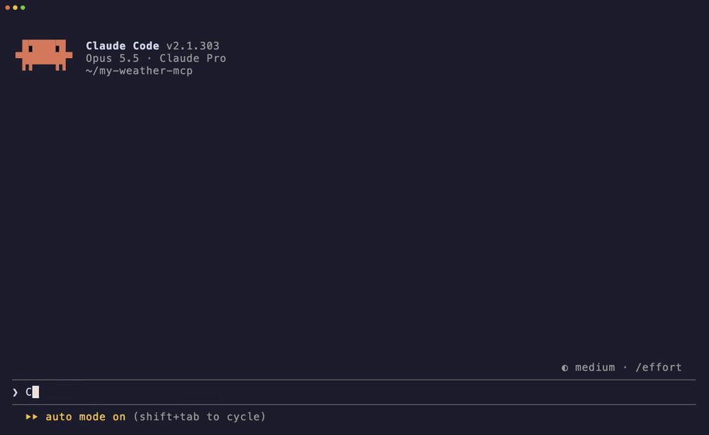
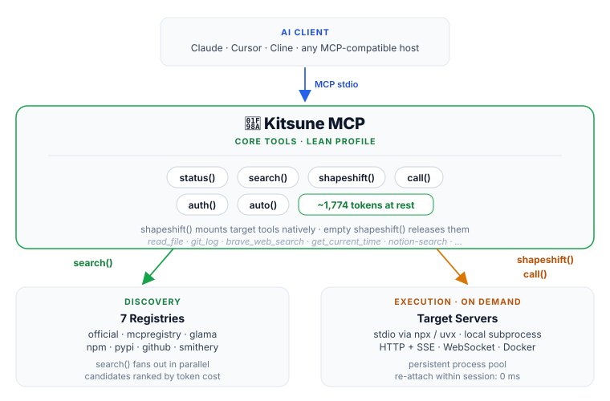

<!-- mcp-name: io.github.kaiser-data/kitsune-mcp -->
<div align="center">
  
  <h1>🦊 Kitsune MCP</h1>
  <h3>One MCP server. Every form your agent needs.</h3>
  <p><strong>Like the nine-tailed fox, it takes any form.</strong> Your agent borrows a server's powers, uses them and casts them off, mid-session, with no client restart.<br/>
  <strong>Build</strong> your own MCP server in a live loop. <strong>Test</strong> any server in seconds, caged.</p>
  <p>
    <a href="https://pypi.org/project/kitsune-mcp/"></a>
    <a href="https://www.npmjs.com/package/kitsune-mcp"></a>
    <a href="https://registry.modelcontextprotocol.io/v0/servers?search=io.github.kaiser-data%2Fkitsune-mcp"></a>
    <a href="https://github.com/kaiser-data/kitsune-mcp/actions"></a>
    <a href="https://scorecard.dev/viewer/?uri=github.com/kaiser-data/kitsune-mcp"></a>
    <a href="#releases-you-can-verify"></a>
    <a href="LICENSE"></a>
  </p>
  <p><a href="#try-it-in-a-minute"><strong>Try it in a minute</strong></a> · <a href="https://kaiser-data.github.io/kitsune-mcp/">Documentation</a> · <a href="https://kaiser-data.github.io/kitsune-mcp/hot-reload/">Hot-reload tutorial</a> · <a href="docs/safety.md">Safety model</a></p>
</div>

<p align="center">
  
  <br/><sub>One prompt: Claude finds the bug, fixes it, reloads, checks again. Real recording, 31 s.</sub>
</p>

## Powers

| Power | Ask your agent | What happens |
|---|---|---|
| **Heal its own tool** | *"Call get_weather. If it's wrong, fix it, reload and check again."* | Edit → `reload("dev")` → call. Same session, no client restart. |
| **Shapeshift on demand** | *"What time is it in Tokyo?"* | `auto()` finds a server, takes its form, answers. Nothing lands in your config. |
| **Test any server in seconds** | *"Find a PDF server and try it on report.pdf."* | Search 6 registries → mount it caged → call → drop. |
| **Sniff before it bites** | *"Score mcp-server-time and benchmark it."* | `test()` grades it 0–100, `bench()` measures p50/p95. |
| **Turn any API into a power** | *"Make a tool for POST https://api.example.com/summarize."* | `craft()`: live at once, kept across restarts. |
| **Cast off the form** | *"Drop it."* | `shapeshift()`: tools gone, session stays. |

`bench()` and `craft()` come with `KITSUNE_TOOLS=all`. The cage needs Docker; without it, community code runs uncaged, with a warning.

## Try it in a minute

The demo server has one planted bug and fixed readings, so it needs no API key. With [uv](https://github.com/astral-sh/uv) and Claude Code installed:

```bash
git clone https://github.com/kaiser-data/kitsune-mcp && cd kitsune-mcp
claude mcp add -s user kitsune -- uvx kitsune-mcp
claude
```

Then paste:

```text
Use kitsune: connect("uv run examples/demo-hot-reload/weather_server.py", name="dev"),
call get_weather for Berlin. If it looks wrong, fix the code, reload("dev") and check again.
```

Berlin comes back at **59°C** (Fahrenheit labelled as Celsius). The agent fixes the conversion, reloads and gets **15°C**, with no restart. Other clients: see [Install](#install).

> **AI agents installing this server** (Cline, Claude Code, Cursor, …): follow [llms-install.md](llms-install.md). No clone or build needed.

## The problem

An MCP client starts each server once and keeps that process. When your agent edits a tool, the client still runs the old code, and the agent can't test its fix until a human restarts or reconnects the client. Trying someone else's server has the opposite problem: it goes into your config and starts as your user, with your files and your API keys.

| Without Kitsune | With Kitsune |
|---|---|
| The agent edits a tool. You restart the client and explain the context again. | `reload("dev")` is a tool call. The agent restarts the server and re-tests in the same session. |
| A throwaway JSON-RPC script checks the wire, not what the client shows. | Tools mount as native client tools with their real schemas. Structured output, images and `isError` pass through unchanged. |
| A server you want to try starts as your user: every env var, API keys included, and your home directory. | `shapeshift("pkg", confirm=True)` runs community code in a Docker cage: no host filesystem, read-only root, all capabilities dropped. |
| A server you need once stays in your config, and its tools in every session. | Mount one tool, use it, `shapeshift()` drops it again. |

## The loop

`connect`, `call` and `reload` are tools, so the agent runs the whole cycle itself:

```python
connect("uv run my-mcp-server", name="dev")  # start your server
shapeshift("dev")  # its tools appear in the client
call("summarize", arguments={"url": "https://example.com"})

# … the agent (or you) edits the tool …

reload("dev")  # restart on fresh code, remount
call("summarize", arguments={"url": "https://example.com"})  # new code, same session
```

No Docker needed: `connect()` runs your own server as a plain local process, so the loop stays fast.

## Why not just a script?

In Claude Code an agent can start a server from Bash and speak JSON-RPC to it. That works for a quick check, and Kitsune doesn't replace it. It adds what a script doesn't have:

1. **It tests what your users get.** After `reload`, the tools are real client tools again, with the same schema, structured output and errors a user sees. A script only tests the raw exchange.
2. **No harness to write.** `connect`, `reload` and `call` replace the script, and the server stays up across many edits.
3. **Other people's code stays contained.** A script runs the server as you. Kitsune asks for consent, cages community packages in Docker, pins the version you approved, and `inspect` probes a server with a stripped environment: only credentials that belong to that server, none of your other keys.
4. **Not every client has a shell.** Claude Desktop gives the agent no Bash; there, Kitsune's tools are the only way to run the loop.

## Install

**One click:**

[](https://cursor.com/en/install-mcp?name=kitsune&config=eyJjb21tYW5kIjoidXZ4IiwiYXJncyI6WyJraXRzdW5lLW1jcCJdfQ==)
[](https://vscode.dev/redirect/mcp/install?name=kitsune&config=%7B%22type%22%3A%22stdio%22%2C%22command%22%3A%22uvx%22%2C%22args%22%3A%5B%22kitsune-mcp%22%5D%7D)
[](https://insiders.vscode.dev/redirect/mcp/install?name=kitsune&config=%7B%22type%22%3A%22stdio%22%2C%22command%22%3A%22uvx%22%2C%22args%22%3A%5B%22kitsune-mcp%22%5D%7D)

Both need [uv](https://github.com/astral-sh/uv) installed (`uvx` runs Kitsune).

**Claude Code**

```bash
claude mcp add -s user kitsune -- uvx kitsune-mcp
```

**Any other client** (Claude Desktop, Cursor, Windsurf, Cline, Zed, …):

```json
{
  "mcpServers": {
    "kitsune": { "command": "uvx", "args": ["kitsune-mcp"] }
  }
}
```

Also on PyPI (`pip install kitsune-mcp`, then `"command": "kitsune-mcp"`) and npm (`npx kitsune-mcp`, delegates to `uvx`).

**Requirements:** Python 3.12+ · [uv](https://github.com/astral-sh/uv) · `node`/`npx` for npm-based servers · Docker optional: not used for hot-reload, only to cage community servers when installed.

## Examples

### Borrow a server you never configured

```python
search("web scraping")
shapeshift("firecrawl", tools=["scrape_url"])  # mount one tool, not the whole server
call("scrape_url", arguments={"url": "https://example.com"})
shapeshift()  # drop it, session stays up
```

### Try a community package, caged

```python
search("pdf", registry="glama")
shapeshift("mcp-pdf-tools", confirm=True)  # npm/PyPI run in hardened Docker when available
call("extract_text", arguments={"path": "report.pdf"})
shapeshift()
```

### Add credentials mid-session

```python
auth("BRAVE_API_KEY", "sk-...")  # saved to ~/.kitsune/.env, no restart
shapeshift("brave", tools=["brave_web_search"])
```

A hosted server that uses OAuth logs in with `auth("server-id")`: a browser flow with PKCE, tokens stored per server URL.

Full live walkthrough: [`docs/demo-realtime.md`](docs/demo-realtime.md).

## When to use it, when not to

| Use Kitsune when… | Skip it when… |
|---|---|
| You're building an MCP server and want an edit/reload loop | You only use 1–3 trusted servers (configure them natively) |
| You want to evaluate community MCP code without installing it for good | Every turn hits the same server (keep it always-on) |
| A task needs a server that isn't in your config | You want lower token use: modern clients already defer tool schemas, so most configured servers cost little up front |
| Your MCP config is crowded ([GATEWAY](docs/configuration.md#gateway-consolidate-always-on-servers)) | You need a sub-second first call (cold mount takes ~1–15 s) |

## How it works

`shapeshift(server_id)` picks a transport (stdio, Streamable HTTP, legacy SSE, WebSocket, Docker), connects, reads `tools/list`, and registers each tool as a native tool with the server's real schema. The client receives `notifications/tools/list_changed` and sees first-class tools, with no wrapper in between. `shapeshift()` with no argument removes them and closes the connection.

Mounted tools appear natively in clients that refresh on `tools/list_changed` (tested: Claude Code and Claude Desktop; see [compatibility](docs/compatibility.md)). In any client, `call()` reaches a mounted tool anyway.

<div align="center">
  <picture>
    <source media="(prefers-color-scheme: dark)"
            srcset="https://raw.githubusercontent.com/kaiser-data/kitsune-mcp/main/docs/architecture-dark.svg"/>
    
  </picture>
</div>

`search()` covers the [official servers repo](https://github.com/modelcontextprotocol/servers), the [MCP Registry](https://registry.modelcontextprotocol.io), [Glama](https://glama.ai/mcp/servers), npm, PyPI, GitHub (`github:owner/repo`). Hosted servers are reached at their own `https://` URL.

## Tools

Default profile: **10 tools**. Standing cost: **~1,900 tokens/turn** on clients that load every tool schema up front (measured with `python examples/benchmark.py`, 2026-11-27); **~70 tokens/turn** on Claude Code with Tool Search, where schemas load only on first use (measured on Claude Code 2.1.319, 2026-11-06).

| Tool | Role |
|---|---|
| `connect(command, name)` | Start a persistent local server, e.g. the one you're developing |
| `reload(name)` | Release, restart on fresh code, remount, in one call |
| `release(name)` | Stop a persistent server |
| `search(query, registry?)` | Search 6 registries |
| `shapeshift(server_id?, tools=[…])` | Mount a server's tools (all or a subset); no argument drops them |
| `call(tool_name, arguments)` | Call a tool; the server is inferred when mounted |
| `auth(var_or_server, value?)` | Set an env key or run an OAuth 2.1 browser flow |
| `auto(task, server_hint=)` | Search, mount and call in one step |
| `status()` | Current form, connection pool, session stats |
| `test(server_id, level?)` | Score a server 0–100 with a fix list: your `connect()`ed server or any registry server |

`KITSUNE_TOOLS=all` (or the `kitsune-forge` command) adds developer tools: `inspect` (schemas, credential check, token cost), `bench` (p50/p95 latency), `compare`, `prewarm`, `craft` (turn any HTTP endpoint into a tool), `setup`, and more. See [`docs/tools.md`](docs/tools.md). Companion skills for Claude Code: `kitsune-dev`, `kitsune-improve`.

## Safety

Reaching thousands of community servers only works if unknown code can be contained.

### Community code

- **Consent first.** npm, PyPI and GitHub sources need `confirm=True`, including GitHub installs found through other registries. The model can set that flag itself, so real approval belongs in your client's tool-approval UI.
- **Docker cage by default** when Docker is installed: no host filesystem, read-only root, `--cap-drop ALL`, `no-new-privileges`, memory and PID limits. Credentials are passed by name, never in argv. Network stays on, so packages can install.
- **Version pins (TOFU).** A later malicious publish doesn't silently replace a version you already ran.
- **`connect()` is for your own code.** It runs the command it is given, as your user, with no consent gate and no cage. Approve `connect` calls in your client.

### Every call

- **Opt-in action guard.** A `~/.kitsune/policy.json` checks each downstream call against allow/ask/deny rules, path roots and a host allowlist. It reads the arguments (paths in commands, `uri`, hosts), not just tool names. `ask` goes to you through MCP elicitation.
- **No double runs.** A call that may have run (a timeout after sending, a broken pipe) is never sent again: Kitsune reports "outcome unknown" instead of retrying a payment or a delete.

### Network

- **SSRF blocked.** `fetch()` and crafted tools refuse private, loopback and cloud-metadata addresses. The address that passed the check is the one connected to, so DNS rebinding can't swap one in. Every redirect is re-checked, and credentials or request bodies never follow a redirect to another origin.
- **OAuth 2.1 done by the book.** PKCE, issuer checks (RFC 8414, RFC 9207), HTTPS on every endpoint that sees a secret, no redirects on token requests.

### Releases you can verify

- Every GitHub release carries Sigstore signatures, and builds are reproducible: the signed files are byte-identical to PyPI's. Check one with `sigstore verify github --repository kaiser-data/kitsune-mcp <file>`.
- Two rounds of external code review (Codex, Grok) in November 2026; every confirmed finding is fixed in 0.25.2–0.25.5. See the [CHANGELOG](CHANGELOG.md).

Don't run it unattended with production admin, billing or security credentials. The full model, including what it does **not** protect against: [`docs/safety.md`](docs/safety.md).

## More

- [Configuration](docs/configuration.md): env and `.env` lookup, tool profiles, sandbox and trust settings, GATEWAY, mount patterns
- [Performance](docs/performance.md): cold/warm latency and token cost compared with always-on servers
- [Transports](docs/transports.md) · [Compatibility](docs/compatibility.md) · [Agent patterns](docs/agent-patterns.md) · [Worked scenarios](examples/scenarios/)
- Listed in: [MCP Registry](https://registry.modelcontextprotocol.io/v0/servers?search=io.github.kaiser-data%2Fkitsune-mcp) · [Glama](https://glama.ai/mcp/servers/kaiser-data/kitsune-mcp) · [MCP Market](https://mcpmarket.com/server/kitsune) · [Awesome MCP Servers](https://github.com/punkpeye/awesome-mcp-servers#aggregators)

⭐ Saved you a restart? [Star it on GitHub](https://github.com/kaiser-data/kitsune-mcp) so other MCP developers find it.

## Why "Kitsune"?

In Japanese folklore the kitsune (狐) is known for what it can *become*: it borrows a form, uses that power, casts it off and returns to itself. That is the product loop.

> *I am not Japanese, and I use this name with the highest respect for the mythology and culture it comes from. The parallel felt too precise to ignore.*

## Contributing

```bash
make dev     # install with dev dependencies
make test    # pytest (runs offline)
make lint    # ruff
```

Issues and PRs welcome: [github.com/kaiser-data/kitsune-mcp](https://github.com/kaiser-data/kitsune-mcp) · [CHANGELOG.md](CHANGELOG.md)

---

*MIT License · Python 3.12+ · Built on [MCP Python SDK](https://github.com/modelcontextprotocol/python-sdk)*
